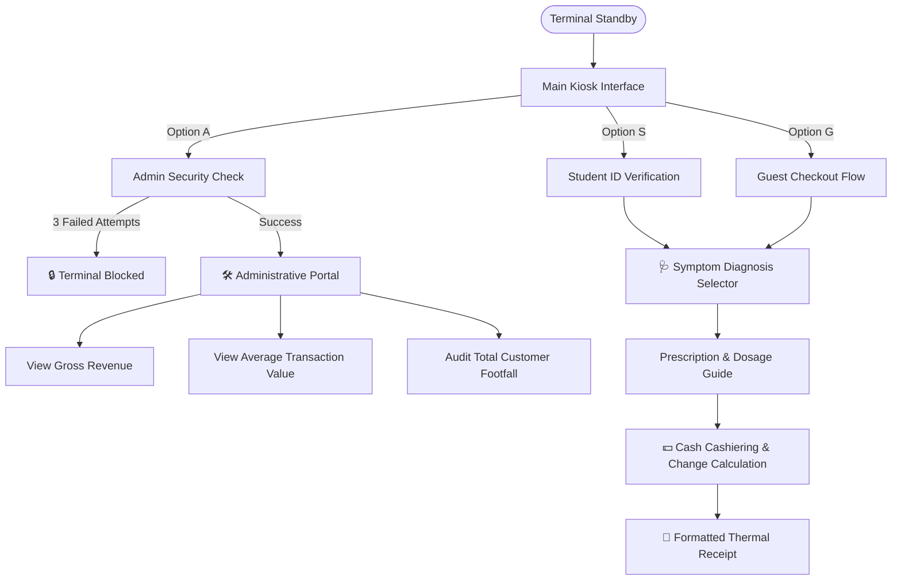

# 💊 Medicine Purchasing System — Automated OTC Smart Vending Terminal

[](https://isocpp.org/)
[](https://microsoft.com)
[]()
[]()
[](LICENSE)

> **Medicine Purchasing System** is a C++ console application that simulates an automated smart vending kiosk for over-the-counter (OTC) pharmaceutical products. Engineered for university campus environments (specifically designed for students at **UiTM Raub Campus**), it enables 24/7 self-service medical dispensing after health center operating hours through symptom-based diagnosis, automated change calculation, and administrative revenue auditing.

---

## 📌 Problem Background & Objectives

University campuses situated outside major metropolitan zones (such as UiTM Raub) often operate health units with strict working hours (closing in the evening and on weekends). When students experience common acute ailments—such as migraines, gastric distress, allergic rhinitis, or sore throats—they are forced to travel long distances or wait until the following morning.

**Medicine Purchasing System** provides:
* **24/7 OTC Access:** Immediate symptom-guided medication selection for common minor conditions.
* **Role-Based Kiosk Access:** Three discrete operating modes for **Registered Students**, **Guest Patients**, and **System Administrators**.
* **Anti-Brute Force Protection:** Strict 3-attempt PIN/credential authorization with hardware lockout simulation (`block()`).
* **Accurate Cashiering & Accounting:** Exact floating-point price calculation, cash validation, change computation, and formatted thermal receipt generation.
* **Managerial Financial Auditing:** Administrative sales logs displaying cumulative customer footfall, gross revenue, and average transaction value.

---

## 👥 Role-Based Terminal Modes



| Mode | Target User | Security | Available Capabilities |
|---|---|---|---|
| **`[A] ADMIN`** | Pharmacy Staff / Health Unit | Password-protected (3 attempts max) | Audits gross accumulated sales (`adminTot()`), calculates average basket size (`adminAvg()`), customer volume counter |
| **`[S] STUDENT`** | Enrolled UiTM Students | Student ID entry | Symptom selection, medication dispensing, student discount processing, itemized receipt |
| **`[G] GUEST`** | Visitors & Campus Staff | Immediate access | General symptom diagnosis, standard OTC pricing, receipt generation |

---

## 🩺 Symptom-to-Medication Diagnostic Engine

The system organizes common OTC medications across 6 medical symptom categories:

| Symptom Category | Function | Sample Medications Dispensed | Common Indications |
|---|---|---|---|
| **Headache & Fever** | `head()` | Paracetamol 500mg, Panadol Actifast | Tension headaches, migraines, low-grade fevers |
| **Eye Irritation** | `eyes()` | Eye Glo Relief, Artificial Tears | Eye strain, conjunctivitis discomfort, dry eyes |
| **Nasal & Congestion** | `nose()` | Cetirizine 10mg, Decongestant Spray | Allergic rhinitis, seasonal flu, runny nose |
| **Oral & Dry Mouth** | `drymouth()` | Oral Rehydration Salts, Hydration Pastilles | Dehydration, dry mouth syndrome |
| **Throat Discomfort** | `throat()` | Strepsils Antibacterial, Difflam Lozenges | Pharyngitis, scratchy throat, coughing |
| **Gastric & Stomach** | `stomach()` | Gaviscon Liquid Sachets, Antacid Tablets | Acid reflux, indigestion, gastritis pain |

---

## 🧾 Sample Checkout & Receipt Output

```text
+================================================+
|              PUASAT KESIHATAN UITM             |
|          MEDICINE VENDING MACHINE #01          |
|------------------------------------------------|
| ITEM                           QTY    PRICE(RM)|
|------------------------------------------------|
| Paracetamol 500mg (Blister)     1       4.50   |
| Strepsils Lozenges (Pack)       1       6.80   |
|------------------------------------------------|
| TOTAL AMOUNT                           RM11.30 |
| CASH TENDERED                          RM20.00 |
| BALANCE CHANGE                         RM 8.70 |
+================================================+
  THANK YOU! PLEASE TAKE YOUR MEDICATION BELOW.
```

---

## 📂 Project Directory Structure

```text
Medicine_Purchasing_System/
├── MEDICINE PURCHASING SYSTEM (C++).cpp  # Complete C++ terminal source code
├── README.md                             # Comprehensive system documentation
└── .gitignore                            # Ignores compiled binaries (.exe, .obj)
```

---

## 🛠️ Compilation & Execution Guide

### 1. Prerequisites
* A C++ compiler supporting C++11 or higher (such as **MinGW GCC**, **Clang**, or **MSVC** on Windows).

### 2. Clone the Repository
```bash
git clone https://github.com/akhmal02/Medicine_Purchasing_System.git
cd Medicine_Purchasing_System
```

### 3. Compile the Source Code
* Using **GCC (MinGW)**:
  ```bash
  g++ -O2 "MEDICINE PURCHASING SYSTEM (C++).cpp" -o MedicinePurchasingSystem.exe
  ```
* Using **MSVC (`cl.exe`)**:
  ```bash
  cl /EHsc "MEDICINE PURCHASING SYSTEM (C++).cpp"
  ```

### 4. Run the Executable
```bash
./MedicinePurchasingSystem.exe
```

---

## 👨‍💻 Authors & Academic Attribution
* **Development Team:**
  * **Muhammad Akhmal bin Mohamad Hussin** ([@akhmal02](https://github.com/akhmal02))
  * Rizalliff Nabil
  * Nik Yusuf
  * Ahmad Benjamin
* **Institution:** Universiti Teknologi MARA (UiTM), Raub Campus
* **Faculty:** Faculty of Computer and Mathematical Sciences (FSKM / CDCS)
* **Course:** Programming I / Object-Oriented Fundamentals (C++)
